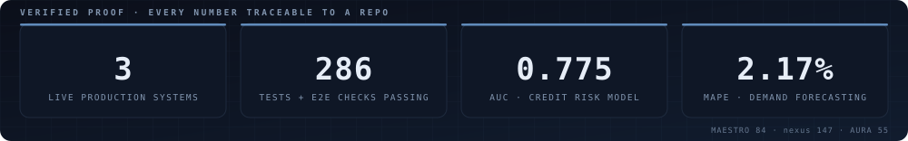

<picture>
  <source media="(prefers-color-scheme: dark)" srcset="assets/hero-dark.svg">
  <source media="(prefers-color-scheme: light)" srcset="assets/hero-light.svg">
  
</picture>

 
 

 

---

## `> whoami`

I am **Oussama Skia** (SKAY) — AI Engineer and Data Scientist based in **Casablanca, Morocco**.

> **Models hallucinate. Systems shouldn't.**

I don't build demos. I build systems that **survive production** — multi-agent orchestration pipelines, RAG engines with epistemic awareness, full-stack AI products that ship and stay shipped. The model is the easy part. The work is the retrieval, the pipelines, and the fallbacks that hold when real input gets messy.

**Three pillars I build toward**

| | |
|:--|:--|
| **Multi-agent AI** | Real LLM planners, typed output contracts, grounded tools, live SSE streaming |
| **Memory & retrieval** | Hybrid BM25 + vector search, contradiction detection, claim-level answer grounding |
| **Data intelligence** | Raw ingestion (tabular, PDF, audio, video, OCR) through to decision-ready insight |

Currently going deep on **production AI** — retrieval, grounding, and agent orchestration.

 

---

## `> ls ./systems`

Three full-stack production AI systems — **live, tested, documented.**

 

### [🎼 MAESTRO](https://github.com/skayy47/maestro) · [Live ↗](https://maestro-lac-theta.vercel.app)

Multi-agent AI command center. An LLM orchestrator plans a DAG of specialist agents (Research · Data · Automation), runs them as a live SSE pipeline, and returns **verifiable artifacts** — sourced market briefs, real CSV statistics, importable n8n workflow JSON.

`Next.js 14` · `TypeScript` · `Groq` · `Tavily` · `Framer Motion`  —  **84/84 tests**

> Hardened against a 12-case live mission battery that caught 8 defects a green test suite had missed: prompt injection echoed into output, planner mis-selection, silent zero-KPI deliverables. All closed with deterministic guards over prompt-hope.

### [🧠 nexus](https://github.com/skayy47/nexus) · [Live ↗](https://nexussss-two.vercel.app)

Institutional-memory RAG engine over **15 document formats**. Hybrid BM25 + pgvector + RRF retrieval, claim-level **answer grounding**, contradiction detection, confidence-gated refusal, real citations. Bilingual EN/FR.

`FastAPI` · `Next.js 14` · `pgvector` · `Groq` · `Supabase` · `Docker`  —  **145 tests**

> RAGAS-evaluated for real — and reported honestly. Context Recall **0.90** (retrieval-only, target 0.75). The generation metrics (Faithfulness 0.768, Answer Relevancy 0.801) were measured on `llama-3.3-70b`, which Groq deprecated in June 2026; generation now runs on `gpt-oss-120b` and those two are pending re-measurement. An earlier eval scored 0.51/0.64/0.70 until I found it was silently running dense-only retrieval and scoring a smaller model than production serves.

### [🔬 AURA](https://github.com/skayy47/AURA) · [Live ↗](https://aura-sooty-five-27.vercel.app)

Universal data engine. Any file → 8-step auto-clean → Plotly explorer → streaming AI chat **grounded in real computed stats** → branded PDF report. Multi-provider AI cascade (Gemini → Groq → GPT-4o → Claude). Bilingual EN/FR.

`FastAPI` · `Next.js 14` · `Pandas` · `Gemini` · `Playwright`  —  **55/55 end-to-end checks** across 5 datasets

 

> **The arc:** AURA proved I can wrangle any data format → nexus proved I can build production memory systems → MAESTRO proves I can architect multi-agent AI at depth. Each system adds a layer the previous one did not have.

 

---

## `> ls ./research-and-ml`

| Project | Signature engineering | Proof |
|:--|:--|:--|
| **🛰️ UrbanSense**   `private · academic` | Real-time urban digital twin — Kafka/Spark streaming, GRU traffic forecasting, false-data-injection defence, and an agentic assistant with **mechanically-verified groundedness**. | PFA ISGA 2025–26 · defended Sept 2026 |
| [**🔭 VERIS**](https://github.com/skayy47/VERIS) | Production research agent on a **custom asyncio state machine** (PLAN→SEARCH→REASON→VERIFY→ANSWER). VERIS-Bench-100, OTel + Prometheus + MLflow observability. **No LangChain.** | [Code ↗](https://github.com/skayy47/VERIS) |
| [**📊 Credit Risk Engine**](https://github.com/skayy47/credit-risk-prediction) | LightGBM on 307,511 Home Credit applicants, 31 engineered relational features. SHAP TreeExplainer, Basel III scorecard (Gini 0.550), isotonic calibration cutting Brier 0.147 → 0.067. Regulatory-grade — not a notebook. | **AUC 0.7748** · [Live ↗](https://credit-risk-prediction-skay.streamlit.app) |
| [**📈 Walmart Forecasting**](https://github.com/skayy47/walmart-sales-forecasting) | End-to-end demand forecasting. XGBoost + Prophet + Optuna tuning + Power BI dashboard. | **MAPE 2.17%** · [Live ↗](https://walmart-sales-forecasting-skay.streamlit.app) |

 

---

## `> cat stack`

| | |
|:--|:--|
| **Languages** | Python · TypeScript · JavaScript · SQL · Bash |
| **LLM · Agents · RAG** | Groq · Gemini · Claude API · OpenAI API · LangChain · multi-agent orchestration · hybrid retrieval (BM25 + pgvector + RRF) · answer grounding · SSE streaming |
| **ML · Data Science** | PyTorch · scikit-learn · LightGBM · XGBoost · Prophet · SHAP · Optuna · Pandas · NumPy · Plotly |
| **Vision · Audio · Docs** | OpenCV · Whisper · Tesseract OCR · Pillow |
| **Backend** | FastAPI · Node.js · Pydantic · REST · Server-Sent Events |
| **Frontend** | Next.js 14 · React · Tailwind CSS · Framer Motion · Streamlit |
| **Data stores** | PostgreSQL · pgvector · Supabase · MongoDB · Redis · ChromaDB |
| **Streaming · Big Data** | Kafka · Spark Structured Streaming |
| **Infra · Observability** | Docker · Vercel · HF Spaces · GitHub Actions · MLflow · Prometheus · OpenTelemetry |

 

---

## `> proof`

<picture>
  <source media="(prefers-color-scheme: dark)" srcset="assets/proof-dark.svg">
  <source media="(prefers-color-scheme: light)" srcset="assets/proof-light.svg">
  
</picture>

 

---

## `> ping me`

 

**🎼 [MAESTRO](https://maestro-lac-theta.vercel.app)** — multi-agent AI &nbsp;·&nbsp; **🧠 [nexus](https://nexussss-two.vercel.app)** — RAG + memory &nbsp;·&nbsp; **🔬 [AURA](https://aura-sooty-five-27.vercel.app)** — universal data AI

 

*Every artifact is verifiable. Every system ships. No demos — products.*

